# SITEMAP & WIREFRAME PORTAL RESMI BUMDES GRAHARTA KANUGRAHAN
*Website Profil, Layanan Publik & Sistem Cek Tagihan Air HIPPAM Terinspirasi PAM JAYA & Android Native App (Material You / M3)*

---

## 1. Executive Summary & Brand Identity
- **Nama Lembaga**: Badan Usaha Milik Desa (BUMDes) Graharta Kanugrahan
- **Pemerintahan**: Pemerintah Desa Kanugrahan, Kecamatan Maduran, Kabupaten Lamongan, Jawa Timur
- **Landasan Hukum**: SK Menkumham RI No. AHU-01928.AH.01.04.Tahun 2022 & Perdes Kanugrahan No. 04 Tahun 2021
- **Tagline Utama**: *"Mengelola Amanah Desa, Mengalirkan Kesejahteraan Bersama"*
- **Filosofi Visual**:
  - **Navy Blue (`#0B3B60`)**: Integritas, tata kelola korporat yang profesional, dan stabilitas penyediaan air.
  - **Emerald Teal (`#0284C7` & `#059669`)**: Kesuburan agraris Desa Kanugrahan, keberlanjutan lingkungan, dan inovasi ramah warga.
  - **Slate & Off-White (`#F8FAFC`)**: Keterbukaan publik (transparansi), kontras tinggi di layar smartphone warga desa dalam kondisi terik matahari.
  - **Target Pengguna**: Warga desa pengguna air HIPPAM/sampah, kelompok tani, pelaku UMKM, perantau Kanugrahan, serta evaluator instansi pemerintah/Dinas PMD.

---

## 2. Struktur Sitemap (Hierarki Navigasi Portal)

```mermaid
graph TD
    AppShell["Android App Shell (PWA + Web Portal)"] --> TopBar["Top Bar / Header (PWA Install + Lonceng Warta)"]
    AppShell --> QuickChips["Action Chips Carousel (Cek, Scan, Lapor, Mart)"]
    AppShell --> Hero["Hero Section & Indikator Debit Pompa HIPPAM"]
    AppShell --> QuickWidget["PAM JAYA Widget 4-Tab (Tagihan, Pasang, Lapor, Mart)"]
    AppShell --> BottomNav["Persistent Bottom Navigation Bar (Android M3)"]

    QuickWidget --> Tab1["1. Cek Tagihan Air & Iuran Warga"]
    QuickWidget --> Tab2["2. Pasang Sambungan Baru"]
    QuickWidget --> Tab3["3. Lapor Gangguan Cepat (WA)"]
    QuickWidget --> Tab4["4. Kanugrahan Mart (Katalog Desa)"]

    AppShell --> Sec1["Metrik Kinerja BUMDes (1.450+ KK, 99.4%, Rp 285 Jt PADes)"]
    AppShell --> Sec2["Profil Direktur & Nilai Pelayanan Amanah"]
    AppShell --> Sec3["4 Unit Usaha Mandiri (Tirta, Mart, Sanitasi, Sewa Tenda)"]
    AppShell --> Sec4["Transparansi Anggaran PADes (Progress Alokasi & Unduh PDF)"]
    AppShell --> Sec5["Warta & Pengumuman (Filter Gangguan & Kegiatan)"]
    AppShell --> Sec6["Pusat Bantuan, FAQ & Hotline WhatsApp"]

    BottomNav --> B1["Beranda"]
    BottomNav --> B2["Tagihan (Air & Sampah)"]
    BottomNav --> B3["Aduan WA (Center Action)"]
    BottomNav --> B4["Toko Desa (Mart & Tani)"]
    BottomNav --> B5["Scan Meter (AI Scanner)"]
```



---

## 3. Arsitektur Wireframe Mobile-First (Android App Style)

### Mobile Layout (Viewport 360px - 480px, Smartphone 3G/4G Desa)
Desain dioptimalkan untuk pengoperasian satu tangan (*one-thumb ergonomics*), *touch target* minimum 48x48px, dan transisi *slide-up bottom sheet*:

```
+------------------------------------------------------+
| [PWA BANNER: BUMDes App ★4.9 1.2MB] [PASANG KE HP] [X]| <- PWA prompt bar
+------------------------------------------------------+
| [LOGO GRAHARTA]              [SCAN] [🔔 NOTIF] [MENU] | <- Top App Bar (H=64px)
+------------------------------------------------------+
| ACTION CHIPS: [💧Cek Tagihan] [📷Scan] [🚨Lapor] [🛒Mart]...| <- Horizontal scroll
+------------------------------------------------------+
| HERO CARD:                                           |
| "Mengelola Amanah Desa, Mengalirkan Kesejahteraan"  |
| [Status Pompa: Aktif 14.8 L/dtk | Tekanan 3.0 Bar]   |
+------------------------------------------------------+
| PAM JAYA QUICK ACTION TABS (Grid 2x2 di Mobile):     |
| [1. Cek Tagihan] [2. Pasang Baru]                    |
| [3. Lapor Gangguan] [4. Toko Desa]                   |
| ---------------------------------------------------- |
| Input: Masukkan ID Pelanggan (Contoh: KNG-2024-001)  |
| [Tombol: CEK TAGIHAN] [Kamera Scan Meter]            |
| *Hasil Pencarian: Kubikasi, Total Rp, Status Lunas   |
+------------------------------------------------------+
| STATS COUNTER BAR (2 Kolom di Mobile):               |
| [ 1.450+ KK Terlayani ]    [ 99.4% Kualitas Air ]    |
| [ 4 Unit Usaha Mandiri ]   [ Rp 285 Jt PADes/Th ]    |
+------------------------------------------------------+
| SAMBUTAN DIREKTUR & KADES:                           |
| Foto pimpinan & 4 pilar: Amanah, Cepat, Terbuka      |
+------------------------------------------------------+
| UNIT USAHA UNGGULAN:                                 |
| - Tirta Kanugrahan (HIPPAM): Pompa & Lab Kemenkes    |
| - Kanugrahan Mart: Pupuk Bersubsidi & Gas 3 Kg       |
| - Lingkungan Bersih: Armada Tossa & Bank Sampah      |
| - Sentra UMKM: Sewa Tenda & Terop Hajatan            |
+------------------------------------------------------+
| TRANSPARANSI & LAPORAN REALISASI ANGGARAN:           |
| Progress Bar Laba Bersih BUMDes & Unduh Berkas PDF   |
+------------------------------------------------------+
| WARTA & PENGUMUMAN DESA:                             |
| Filter: [Semua] [Perbaikan Pipa] [Kegiatan Desa]     |
+------------------------------------------------------+
| FAQ ACCORDION (Jadwal Baca Meter 25-28, Tempo Tgl 20)|
+------------------------------------------------------+
| FOOTER LEGALITAS & KONTAK:                           |
| SK Kemenkumham RI | Balai Desa Kanugrahan            |
+------------------------------------------------------+
| PERSISTENT ANDROID BOTTOM NAVIGATION BAR:            |
| [ 🏠Beranda ] [ 📄Tagihan ] [ 🎧ADUAN WA ] [ 🛒Toko ] [ 📷Scan ]|
+------------------------------------------------------+
```

---

## 4. Fitur Interaktif Android Native App yang Diimplementasikan
1. **Material You Bottom Navigation Bar**:
   - Selalu terpasang di bagian bawah layar smartphone dengan indikator kapsul aktif (*active pill*), umpan balik sentuhan (*haptic-like scale 90%*), dan tombol aduan tengah yang menonjol.
2. **Android Bottom Sheet Modals**:
   - Seluruh modal pada layar ponsel otomatis berubah menjadi *Bottom Sheet* yang meluncur mulus dari bawah layar lengkap dengan *drag handle pill* di atasnya.
3. **Smart Meter Scanner Simulator**:
   - Fitur pemindai meter air cerdas dengan jendela bidik digital, garis laser pemindai bergerak, dan otomatisasi input angka pemakaian kubikasi air ke form cek tagihan.
4. **Notification Drawer Tray**:
   - Ikon lonceng di header memunculkan pemberitahuan terkini seputar tagihan terbit, status kelancaran pompa air, dan pasokan pupuk pertanian.
5. **PWA Install Banner**:
   - Banner pemasangan aplikasi super ringan (1.2 MB) berperingkat bintang 4.9.
